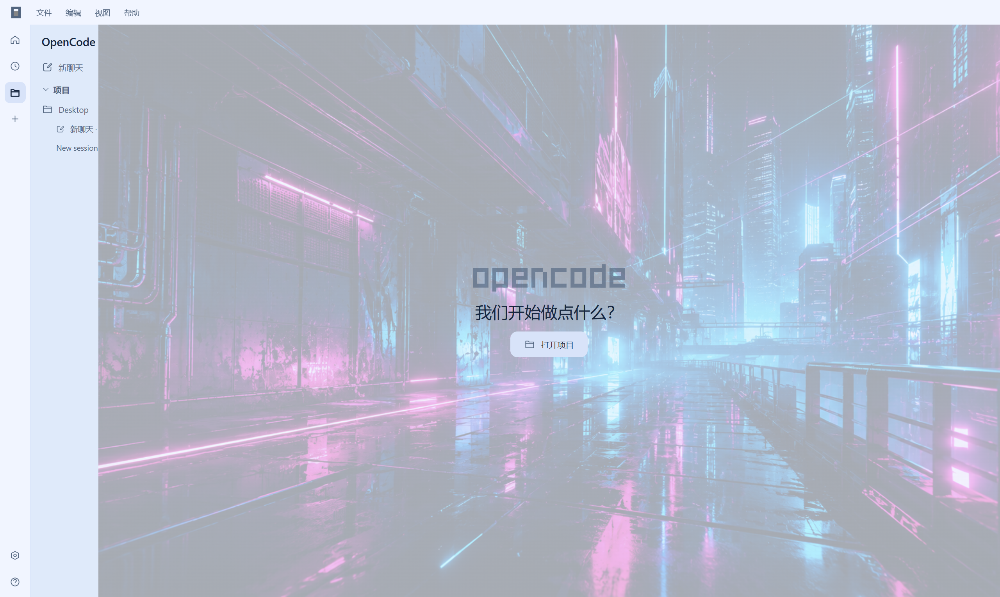
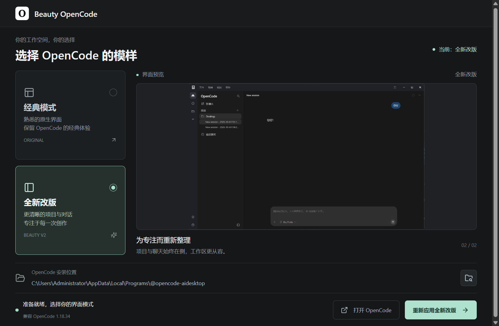
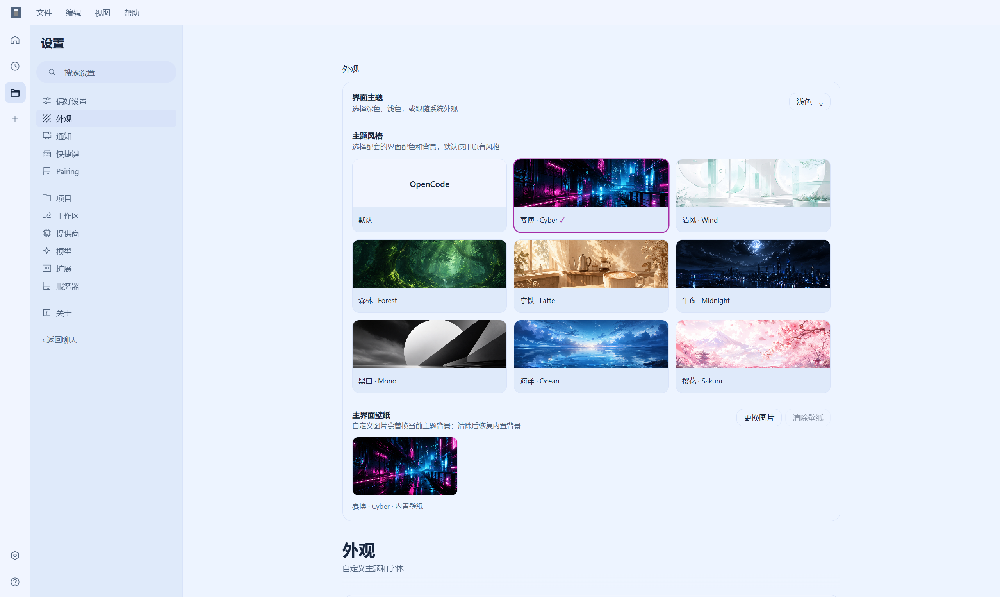

<p align="center"></p>

<h1 align="center">Beauty OpenCode</h1>
<p align="center"><strong>让 OpenCode 拥有更舒适的桌面布局</strong></p>
<p align="center">Codex 风格导航 · 原生会话与模型 · 八套主题 · 一键恢复</p>
<p align="center">   </p>
<p align="center"><a href="#界面预览">界面预览</a> · <a href="#开始使用">开始使用</a> · <a href="#开发与打包">开发与打包</a> · <a href="docs/technical-notes.md">技术说明</a></p>

---

Beauty OpenCode 是为 **Windows Electron 版 OpenCode** 制作的独立布局与主题补丁。它重新整理导航、项目侧栏、聊天输入区和设置页，同时接入 OpenCode 原生会话、模型、提供商和文件功能。

由 **[炽阳001](https://space.bilibili.com/404891612)** 开发 · [GitHub 主页](https://github.com/Chiyang001?tab=repositories)

## 界面预览

<p align="center"></p>
<p align="center"><em>项目与最近聊天集中展示，常驻侧栏让切换更直接。</em></p>

| 桌面切换工具 | 设置与主题 |
| :---: | :---: |
|  |  |

## 你可以做什么

| 功能 | 体验 |
| --- | --- |
| 项目与聊天导航 | 项目分组、最近聊天、搜索、置顶、重命名和草稿切换 |
| 更整洁的对话区 | 底部输入框、原生项目信息条、圆形发送与停止按钮 |
| 个性化外观 | 八套预设主题、深浅色及跟随系统、自定义壁纸 |
| 分类设置页 | 分类导航、搜索与卡片布局，保留原生设置控件 |
| 桌面操作 | 文件 / 编辑 / 视图 / 帮助菜单、Windows 窗口控件、`Ctrl+B` 切换侧栏 |
| 备份与恢复 | 保留原始资源，校验完整性，一键恢复经典模式 |

## 开始使用

1. 完全退出 OpenCode。
2. 双击便携版 `Beauty-OpenCode-Electron.exe`，无需安装 Python 或 Node.js。
3. 选择“全新改版”或“经典模式”，查看界面预览后点击“应用”。
4. 点击“打开 OpenCode”开始使用。

> 便携版通过下方构建命令生成，输出到 `dist/electron/`。本仓库保存源码与资源，不附带可执行文件，也不发布 Release 包。

## 兼容与恢复

- 适用于 Windows Electron OpenCode，已在 **2.0.26** 原包上完成补丁完整性与恢复验证。保留 **1.18.x** 旧架构适配。
- 支持 `@opencode-ai/desktop` 和 `@opencode/desktop` 包名。应用前检查资源结构与挂载点，结构变化时会停止写入。后续版本的兼容性取决于其结构。
- 原始备份为 `resources/app.asar.beauty-original`，校验记录为 `resources/beauty-opencode.json`。
- 使用 SHA-256 校验、临时文件及原子替换。OpenCode 运行期间拒绝修改。资源被升级或被其他程序修改时，拒绝用旧备份覆盖。
- **更新 OpenCode 前，请先切换回经典模式。**

> 本项目不是官方 OpenCode 插件。它提供视觉和导航布局调整，不包含 Codex 的后端、账户或任务管理服务。

## 开发与打包

需要 Node.js 与 npm。Windows 打包还需要 PowerShell。

```powershell
npm ci
npm start
npm test
npm run build
```

`npm run build` 从 `logo.png` 生成程序图标，再构建 Windows x64 便携可执行文件：

```text
dist/electron/Beauty-OpenCode-Electron.exe
```

构建结束前会逐字节校验打包的源码、图片、主题和截图，确认它们与本地输入文件一致。

| 路径 | 用途 |
| --- | --- |
| `electron/` | Electron 界面、补丁引擎、ASAR 处理与自动化测试 |
| `assets/` | 导航外壳、样式、原生桥接及图标 |
| `themes/` | 八套主题图片 |
| `screenshots/` | 实际界面预览 |
| `scripts/build-icon.ps1` | 从程序 logo 生成 PNG 与 ICO 图标 |
| `beauty.py` / `asar.py` / `verify.py` | 保留的 Python 工具与历史验证实现 |
| `docs/technical-notes.md` | 迁移、版本改动与验证细节 |

旧 Python 工具可通过 `python beauty.py` 运行，Electron 便携版运行时不调用 Python。

---

<p align="center">开发者：<a href="https://space.bilibili.com/404891612">炽阳001 · Bilibili</a> · <a href="https://github.com/Chiyang001?tab=repositories">GitHub</a></p>
